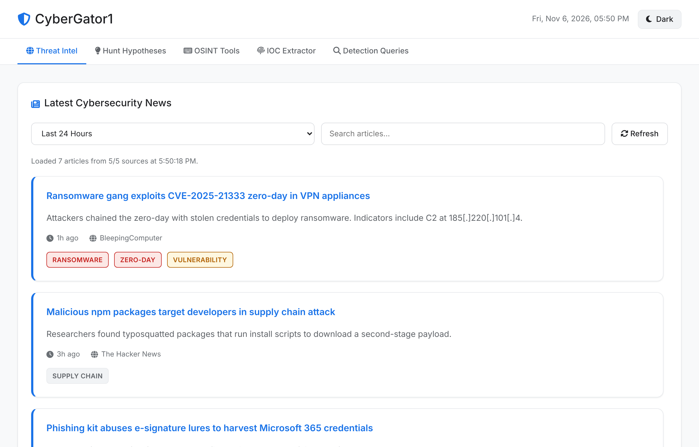
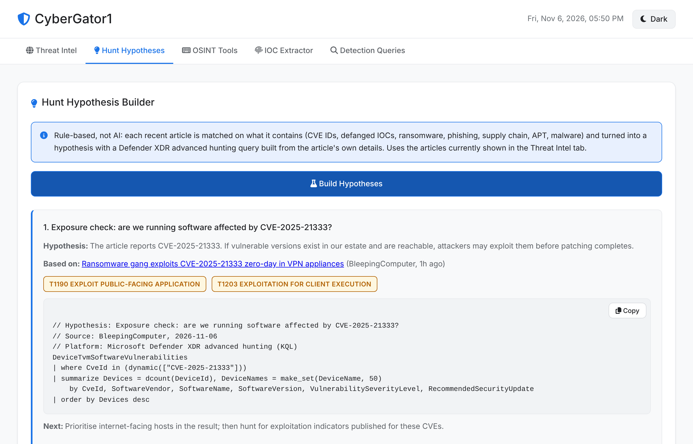
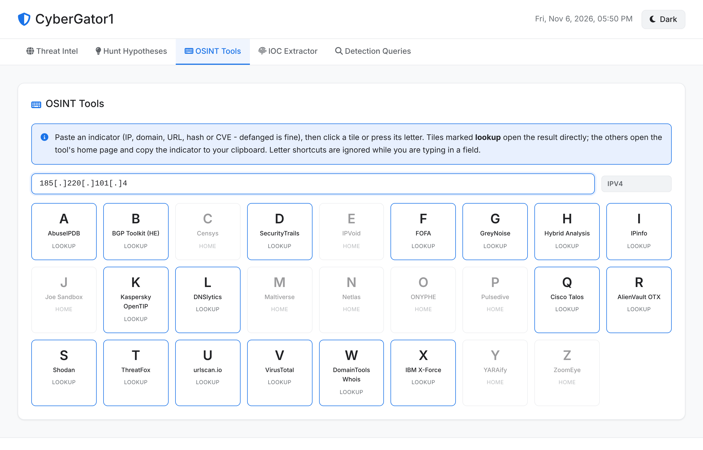
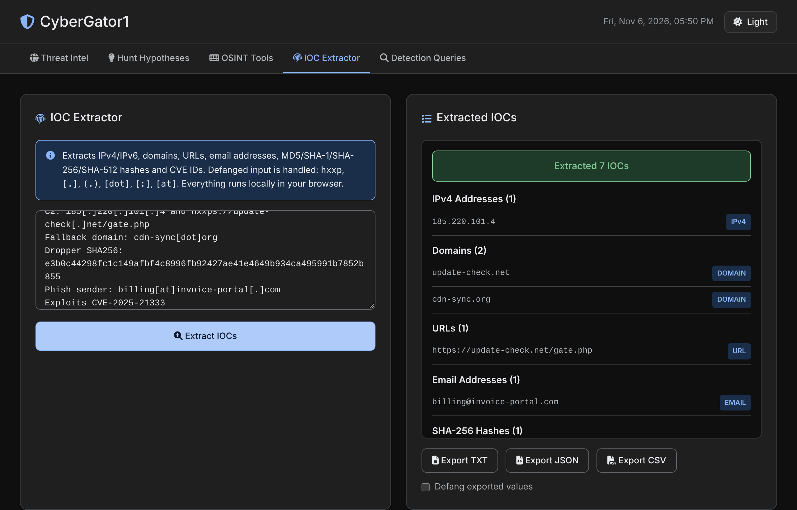
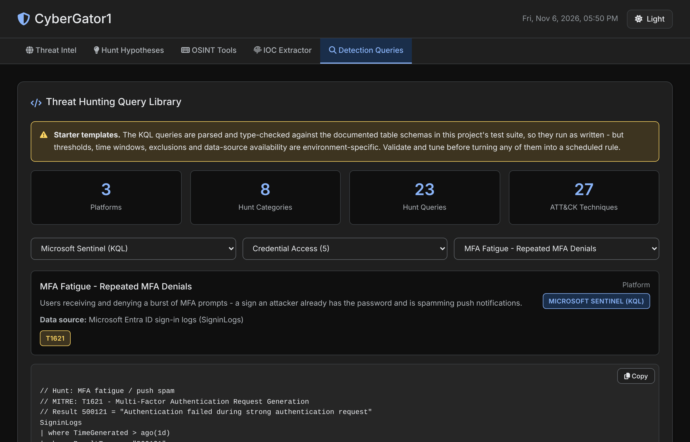
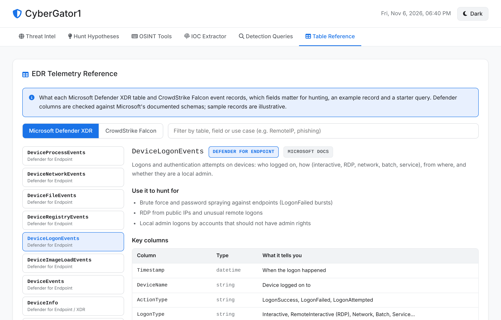
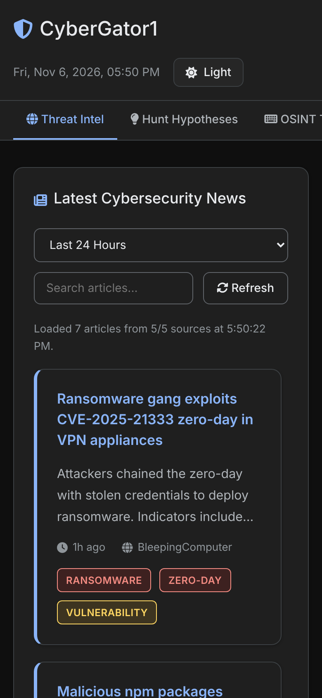

# CyberGator1 - Threat Hunting Command Center 🛡️

[](https://github.com/indocanadian416/THQV/actions/workflows/ci.yml)
[](LICENSE)


**Live Demo:** [https://indocanadian416.github.io/THQV/](https://indocanadian416.github.io/THQV/)

A single-page threat hunting dashboard for SOC analysts, threat hunters and detection engineers. Plain HTML/CSS/JavaScript - no framework, no build step, no backend. Everything except the news feed runs locally in your browser.



---

## 🚀 Features

### 1. Threat Intel feed
- Aggregates BleepingComputer, The Hacker News, Krebs on Security, SecurityWeek and Dark Reading (via the free [rss2json.com](https://rss2json.com) proxy).
- Auto-tags articles: Ransomware, Zero-Day, Vulnerability, APT, Phishing, Malware, Data Breach, Supply Chain.
- Time filters (today / 24h / 7d / all) and live search.
- **Active Threats** and **Feed Metrics** are computed from the last 7 days of loaded articles (tag counts, CVEs mentioned, sources) - nothing is hard-coded.
- Results are cached for 15 minutes; if the proxy is down or rate-limited the page says which sources failed and falls back to the cache.

### 2. Hunt Hypothesis Builder (rule-based)
Turns the articles currently shown into up to 10 hunt hypotheses. **This is rule-based, not AI**: each article is matched on what it contains and the best rule builds a Microsoft Defender XDR advanced hunting query from the article's own details:

| Rule | Triggered by | Generated hunt |
|---|---|---|
| CVE exposure | CVE IDs in the article | `DeviceTvmSoftwareVulnerabilities` for those CVEs |
| IOC retro-hunt | Defanged IPs/domains in the article | `DeviceNetworkEvents` for those indicators |
| Ransomware | Ransomware tag/keywords | Mass file-rename bursts |
| Phishing | Phishing tag/keywords | Delivered email with subjects matching headline keywords |
| Supply chain | npm/PyPI/package/supply-chain | Package managers spawning shells/downloaders |
| APT | APT / state-sponsored / backdoor | Rare outbound destinations (low-volume C2) |
| Malware | Malware / stealer / loader | LOLBins downloading payloads |
| Fallback | anything else | Uploads to personal cloud storage |

Each hypothesis links the source article and the MITRE ATT&CK techniques.

### 3. OSINT keyboard (A-Z) with indicator pivoting
Paste an indicator (IP, domain, URL, hash, CVE - defanged is fine) and click a tile or press its letter. Tiles marked **lookup** open the result page directly (VirusTotal, AbuseIPDB, Shodan, GreyNoise, OTX, ThreatFox, urlscan, X-Force, Talos, …). Tools without a stable deep link open their home page and copy the indicator to the clipboard. Letter shortcuts are ignored while typing in a field.

### 4. IOC Extractor
- Extracts **IPv4, IPv6, domains, URLs, email addresses, MD5 / SHA-1 / SHA-256 / SHA-512 hashes and CVE IDs**.
- Re-fangs defanged input: `hxxp(s)`, `fxp`, `[.]`, `(.)`, `{.}`, `[dot]`, `[:]`, `[://]`, `[@]`, `[at]`.
- Filters out file names that look like domains (`invoice.pdf`, `run.ps1`), invalid IPs (`1.2.3.999`), version strings, times and MAC addresses.
- Export as TXT, JSON or CSV, optionally defanged. CSV values are quoted and protected against spreadsheet formula injection.

### 5. Detection query library
**66 hunting queries** across 3 platforms, 14 categories and 54 ATT&CK techniques, with full-text search (name, ATT&CK ID, table or keyword):

| Platform | Queries | Data sources |
|---|---|---|
| Microsoft Sentinel (KQL) | 24 | SigninLogs, AuditLogs, OfficeActivity, AzureActivity, SecurityEvent, CommonSecurityLog, DnsEvents, Defender XDR tables |
| Microsoft Defender XDR advanced hunting (KQL) | 23 | Device* tables, Identity*, Email*, UrlClickEvents, CloudAppEvents, AlertInfo/AlertEvidence |
| CrowdStrike Falcon LogScale (CQL) | 19 | ProcessRollup2, NetworkConnectIP4, DnsRequest, UserLogon, UserLogonFailed2, ScheduledTaskRegistered, NewExecutableWritten, FileOpenInfo |

Categories: Initial Access, Execution, Persistence, Privilege Escalation, Defense Evasion, Credential Access, Discovery, Lateral Movement, Collection & Exfiltration, Command and Control, Impact, Identity & Cloud, and Triage & Correlation.

Every query lists the data source it needs. **All 47 KQL queries are parsed and type-checked** against the documented table schemas with Microsoft's own Kusto parser in the test suite (see below), so syntax errors and non-existent columns are caught automatically. Thresholds and exclusions still need tuning for your environment.

### 6. EDR table reference (Defender XDR + CrowdStrike Falcon)
A field guide for people who operate these EDRs:
- **19 Microsoft Defender XDR tables** (DeviceProcessEvents, DeviceNetworkEvents, DeviceLogonEvents, DeviceEvents, EmailEvents, IdentityLogonEvents, CloudAppEvents, AlertEvidence and more)
- **11 CrowdStrike Falcon event types** (ProcessRollup2, NetworkConnectIP4, DnsRequest, UserLogon, UserLogonFailed2, ScheduledTaskRegistered, AsepValueUpdate and more), plus how Falcon events join together (aid + TargetProcessId/ContextProcessId)

For each one: what it records, what to hunt for with it, the key columns/fields and what they tell you, common ActionType values, an illustrative sample record, a starter query, and links to every library query that uses it. Defender columns and types are checked against Microsoft's documentation in the tests; CrowdStrike fields that could not be confirmed publicly are flagged **verify**.

### 7. Dark/light theme
Follows your OS preference by default; your choice is remembered.

---

## 📸 Screenshots

*Screenshots use sample feed data.*

| Hunt hypotheses | OSINT pivoting |
|---|---|
|  |  |
| **IOC extractor (dark theme)** | **Detection query library** |
|  |  |
| **EDR table reference** | |
|  | |

<p align="center"></p>

---

## 🔒 Security

- All feed content is rendered with `textContent`; links are restricted to `http(s)`. A malicious or compromised feed cannot inject script.
- Strict Content-Security-Policy: scripts only from this site, styles/fonts only from this site and jsDelivr, network only to rss2json.
- Font Awesome is loaded with Subresource Integrity (SRI).
- External links and OSINT tabs open with `noopener noreferrer`.

---

## 🗂️ Project structure

```
index.html            Page markup (no inline scripts or styles)
css/styles.css        Styles and light/dark theme tokens
js/theme-init.js      Applies the saved theme before first paint
js/utils.js           Escaping, safe URLs, HTML-to-text, feed date parsing, safe storage
js/ioc.js             IOC re-fang / extract / classify / export
js/queries.js         Hunting query library
js/osint.js           OSINT tools and indicator pivot URLs
js/hypothesis.js      Rule-based hypothesis builder
js/tables.js          Defender XDR table and CrowdStrike event reference
js/app.js             UI wiring
tests/                Unit tests (node:test) and tests/e2e/ browser tests (Playwright)
docs/screenshots/     README screenshots
```

Each `js/` module works both as a plain browser script (attaches to `window.THQV`) and as a Node module for testing.

---

## 🚀 Quick start

**Use it:** visit the [live demo](https://indocanadian416.github.io/THQV/).

**Run locally:** clone and open `index.html` in a modern browser, or serve the folder:
```bash
git clone https://github.com/indocanadian416/THQV.git
cd THQV
python3 -m http.server 8000   # then open http://localhost:8000
```

**Deploy your own:** fork → Settings → Pages → Deploy from a branch → `main` / root.

---

## 🧪 Tests

Requires Node.js 18+.
```bash
npm install                        # dev tools only: Kusto parser + Playwright
npm test                           # 143 unit tests incl. KQL parse/type-check of every query
npx playwright install chromium    # once
npm run test:e2e                   # 11 browser tests against the real page
npm run check                      # syntax check of every browser script
```
- **Unit tests** cover IOC extraction/export, URL and HTML sanitising, feed date parsing, OSINT URL building and hypothesis generation, and validate **every KQL query** (library and generated) with Microsoft's Kusto parser against the table schemas in `tests/kql-schema.js` (taken from Microsoft Learn). LogScale queries are linted for legacy SPL syntax.
- **Browser tests** load `index.html` in headless Chromium with mocked feeds containing XSS payloads, `javascript:` links, failing sources and UTC timestamps, then drive every tab: tabs/keyboard, OSINT pivots and popups, IOC extraction and downloads, query library, hypotheses, theme persistence, feed cache and phone-width layout.

CI runs both on every push and pull request.

---

## 🔧 Customisation

- **Feeds:** edit `FEEDS` in `js/app.js`. If you add a new proxy host, also add it to `connect-src` in the CSP `<meta>` tag in `index.html`.
- **OSINT tools:** edit `osintTools` in `js/osint.js`. Add a `build(value, type)` function and `types` to enable direct lookups.
- **Queries:** add entries to `huntingQueries` in `js/queries.js` (`name`, `mitre`, `requires`, `desc`, `query`). If a KQL query uses a new table or column, add it to `tests/kql-schema.js` after checking Microsoft's docs; `npm test` will tell you if anything doesn't parse.
- **Hypothesis rules:** edit `RULES` in `js/hypothesis.js`.
- **Table reference:** edit `defenderTables` / `crowdstrikeEvents` in `js/tables.js`. Defender columns must exist in `tests/kql-schema.js` with the same type, and starter queries are validated like the library.

---

## 🐛 Known limitations

- The news feed depends on the free rss2json.com service (rate limited, ~10-15 items per feed). The page caches results and reports failures, but cannot fetch feeds without it.
- IOC extraction is regex-based. File-like TLDs (`.zip`, `.sh`, `.py`, `.mov`) are treated as file names, not domains.
- CrowdStrike LogScale queries are linted but cannot be executed outside Falcon; field availability depends on your sensor policy (e.g. `FileOpenInfo`).
- Some OSINT tools (Censys, IPVoid, Joe Sandbox, Maltiverse, Netlas, ONYPHE, Pulsedive, YARAify, ZoomEye) open their home page because they have no stable public deep-link format.
- Queries are starting points - tune thresholds, exclusions and time windows before scheduling them.

---

## 🤝 Contributing

See [CONTRIBUTING.md](CONTRIBUTING.md) for setup, tests and how to add queries, OSINT tools or hypothesis rules. Report security issues privately - see [SECURITY.md](SECURITY.md). Release notes are in [CHANGELOG.md](CHANGELOG.md).

---

## 📜 License

[MIT](LICENSE)

## 👤 Author

**Pratik (CyberGator)** - GitHub: [@indocanadian416](https://github.com/indocanadian416)

For issues or questions, open an [issue](https://github.com/indocanadian416/THQV/issues) with your browser/OS details.
